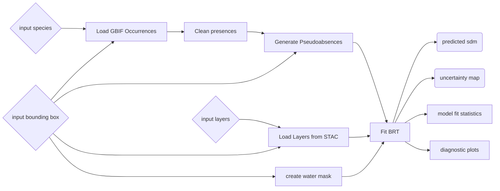

La répartition des espèces est un EBV important dans la classe des espèces. Il est essentiel de savoir où sont les espèces pour comprendre les modèles de biodiversité et orienter les efforts de conservation. Toutefois, moins de 10 % du monde est bien échantillonné, et même les réseaux d'observation de la biodiversité les plus anciens et bien échantillonnés présentent des lacunes importantes. L'information sur les espèces occurrences est souvent clairsemée et fortement biaisée spatialement et taxonomiquement, ce qui nécessite des modèles de répartition des espèces (SDM) pour combler ces lacunes et fournir une meilleure idée, moins biaisée, de l'endroit où se trouvent les espèces. SDM sorties être utilisé comme base principale couches à des fins très diverses, notamment : créer des cartes pour l'établissement des priorités d'échantillonnage, quantifier l'impact des facteurs de stress environnementaux sur les espèces, cartographier l'aptitude de l'habitat pour les espèces en péril, cartographier les points chauds de la biodiversité à travers le paysage, identifier les emplacements des priorités de conservation et l'expansion de aire protégée, identifier les lacunes d'échantillonnage et les emplacements nécessaires pour l'échantillonnage futur, et calculer une gamme d'indicateurs de biodiversité, y compris le Indice d'habitat des espèces (SHI), l'indice de protection des espèces (IPS)

### **MaxEnt**

_Auteurs: [Sarah Valentin](https://orcid.org/0000-0002-9028-681X), [Guillaume Larocque](https://orcid.org/0000-0002-5967-9156), [François Rousseu](https://orcid.org/0000-0002-2400-2479)_

Statut de révision: En développement

### **Introduction:**
  Le pipeline MaxEnt construit un modèle de répartition des espèces à l'aide des enregistrements occurrence du [Système mondial d'information sur la biodiversité (GBIF)](https://www.gbif.org/) et du raster couches environnemental du [Catalogue GEO BON STAC](https://stac.geobon.org/). Le pipeline récupère les observations GBIF pour le taxon sélectionné ou taxons, nettoie les coordonnées occurrence, élimine les prédicteurs environnementaux hautement colinéaires, génère points d'arrière-plan, et s'adapte à un modèle MaxEnt en utilisant l'ENMeval package R (Kass et al. 2021). MaxEnt est une approche de modélisation de la présence-arrière-plan, ce qui signifie qu'elle compare la présence d'espèces connues avec les conditions environnementales de fond dans le zone d'étude. Le MaxEnt SDM est exécuté par 1\) partitionnant occurrence et points d'arrière-plan en sous-ensembles pour la formation et l'évaluation, 2\) construisant le modèle avec différents paramètres algorithmiques (modélisation), et 3\) évaluant leurs performances ([voir la vignette du paquet](https://jamiemkass.github.io/ENMeval/articles/ENMeval-2.0-vignette.html#partition)). Enfin, le pipeline calcule l'intervalle de confiance à 95 % à l'aide de techniques de piégeage et de validation croisée.

  Le pipeline évalue différents paramètres MaxEnt, y compris classes de variables et les multiplicateurs de régularisation, et sélectionne un modèle à l'écoute en fonction des performances du modèle. Il produit une qualité d'habitat prédiction raster, des enregistrements occurrence nettoyés, des prédicteurs environnementaux sélectionnés, une DOI de téléchargement GBIF et une raster résumant la variabilité entre les modèles.

### **Utilisations :**

  Les DSM prédisent où les espèces sont susceptibles de se produire en fonction d'une série de variables environnementales associées au occurrences connu (Peterson, 2001; Elith et Leathwick, 2009). Le pipeline MaxEnt peut être utilisé pour estimer la répartition potentielle ou la pertinence relative de l'habitat d'une ou de plusieurs espèces dans un zone d'étude sélectionné. Sorties peut appuyer la planification de la conservation, l'établissement de priorités en matière d'échantillonnage, l'identification des points chauds de la biodiversité, la planification aire protégée, l'évaluation des risques pour les espèces préoccupantes de conservation et les évaluations de l'impact environnemental.

  Les résultats peuvent également être utilisés comme intrants pour d'autres analyses et indicateurs de la biodiversité, comme l'identification des zones où les espèces sont susceptibles de se produire, la comparaison de la qualité de l'habitat prévue d'une région à l'autre ou la mise en évidence des zones où un échantillonnage occurrence supplémentaire peut être nécessaire. Comme le pipeline récupère à la fois les observations GBIF et le prédicteur environnemental couches, il fournit un flux de travail reproductible pour produire des cartes de distribution des espèces à partir de données publiques sur la biodiversité et l'environnement.

 ## **Limites du pipeline:**

  * MaxEnt utilise des données de présence-arrière-plan, non confirmées. Prédictions doit être interprété comme une aptitude relative à l'habitat ou un potentiel relatif occurrence, et non comme une présence ou une absence confirmées d'espèces.

  * Les enregistrements GBIF peuvent contenir des biais spatiaux, taxonomiques et temporels. Le pipeline applique des étapes de nettoyage des coordonnées, mais les utilisateurs doivent toujours inspecter les présences nettoyées et interpréter les résultats avec prudence, en particulier pour les régions ou les taxons mal échantillonnés.

  * La qualité du modèle dépend fortement du nombre et de la qualité des enregistrements occurrence. Un très petit nombre de présences nettoyées peut produire prédictions peu fiable.

  * Le choix des prédicteurs environnementaux, la méthode d'échantillonnage de fond, classes de variables, les multiplicateurs de régularisation et la méthode de partitionnement peuvent affecter sorties du modèle. Les utilisateurs doivent considérer le modèle comme sensible à ces paramètres, en particulier pour les analyses finales.

  * Les prédicteurs environnementaux doivent être pertinents sur le plan écologique pour l'espèce à l'étude. L'inclusion de nombreux prédicteurs corrélés ou non pertinents peut réduire la capacité d'interprétation et augmenter le risque de suradaptation.

  * Le pipeline estime la pertinence en fonction du prédicteur couches fourni par l'utilisateur. Il ne tient pas compte directement des limites de dispersion, des interactions biotiques, des obstacles à l'utilisation des terres, de la détectabilité des espèces ou des changements environnementaux futurs, à moins que ces facteurs ne soient représentés dans les données d'entrée.

  * De plus grandes zones d'étude, des résolutions spatiales plus fines, plus de prédicteurs environnementaux et plus de modèles augmentent le temps de calcul et l'utilisation de la mémoire.

## **Avant de commencer :**

  Une clé d'API GBIF est nécessaire pour exécuter ce pipeline et peut être ajoutée dans le fichier runner.env.

  Avant Exécution du pipeline, choisissez le taxon ou taxons que vous souhaitez modéliser et assurez-vous que les noms correspondent à la colonne vertébrale taxonomique GBIF. Les noms d'espèces peuvent être vérifiés sur le [Site web GBIF](https://www.gbif.org/).

  Sélectionnez un zone d'étude en utilisant les entrées emprise et SCR. La résolution SCR et la résolution spatiale déterminent l'échelle de l'analyse, donc choisissez un SCR approprié pour la région et assurez-vous que la résolution spatiale se trouve dans les unités de ce SCR.

  Choisissez le prédicteur environnemental couches du [Catalogue STAC](https://stac.geobon.org/) qui est écologiquement pertinent pour l'espèce à l'étude. Par exemple, le climat, la végétation, altitude, couverture du sol ou les prédicteurs liés à l'habitat peuvent être appropriés selon l'espèce. Évitez d'inclure de nombreux prédicteurs qui représentent le même gradient environnemental sous-jacent.

## **Exécution du pipeline:**
### Entrées du pipeline
Le pipeline BON in a Box vous permet d'exécuter un SDM pour une région et une espèce spécifiques (ou plusieurs espèces) d'intérêt. Le pipeline possède les intrants suivants:

- **Liste taxons :** Liste séparée par des virgules de [Taxons](https://en.wikipedia.org/wiki/Taxon). Chaque valeur pourrait être un nom d'espèce, un ordre, une classe, un genre, un royaume ou une famille, tant qu'elle correspond exactement à la colonne vertébrale taxonomique GBIF. Les espèces individuelles peuvent être consultées [sur le site GBIF](https://www.gbif.org/species/).
- **Groupe taxonomique:** Grand groupe taxonomique utilisé pour récupérer la carte thermique de densité d'observation GBIF pour l'échantillonnage du point de fond. Choisissez le groupe qui correspond le mieux au modèle taxons, ou tous pour toutes les observations GBIF.
- **Emprise et SCR:** emprise et système de coordonnées de référence définissant l'étendue de l'analyse. Cette étendue est utilisée pour récupérer GBIF occurrences, le prédicteur environnemental rasters, la carte thermique de l'effort d'échantillonnage GBIF et l'étendue de l'étude pour la modélisation.
- **Zone d'étude:** Polygone du zone d'étude, au format GeoPackage. Pour utiliser un zone d'étude personnalisé, entrez le chemin vers le fichier dans les données utilisateur (par exemple /userdata/study area polygon.gpkg) et il va recouvrir la zone à la forme du polygone. Laisser vide pour utiliser emprise et SCR choisis ci-dessus.
- **Résolution spatiale :** Résolution spatiale cible pour la carte thermique rasters et GBIF. Les unités doivent correspondre au SCR, par exemple les compteurs pour SCR projeté ou les degrés pour la latitude-longitude SCR.
- **Résolution temporaire :** Résolution temporelle à utiliser lors de la requête de items STAC par date, dans le format ("P", intervalle de temps et unité de temps, par exemple "P1Y" est annuel, "P1M" est montly et "P1D" est quotidien). Laisser vide si ce n'est pas par date. Si la résolution temporelle est plus grossière que la résolution temporelle des séries chronologiques, le couches sera agrégé avec la méthode d'agrégation choisie ci-dessous.
- **Minimum et année maximale :** L'utilisateur peut spécifier la plage d'année pour laquelle il souhaite tirer des observations GBIF.
- **STAC URL:** URL du catalogue STAC utilisé pour récupérer le prédicteur environnemental couches.
- **items de collection STAC:** Pour tirer items de collection spécifique, entrez le nom de la collection suivi de '|' suivi d'un élément id (par exemple "chelsa-clim|bio1"). Pour extraire une collection entière, tapez uniquement le nom de la collection (par exemple "chelsa-clim"). Pour tirer items de collection par date, écrivez le nom de la collection et fournissez une date de début, une date de fin et une résolution temporelle. Si vous tirez un calque carrelé (par exemple https://stac.geobon.org/viewer/gfw-lossyear/_80N_180W), entrez le nom de la collection (par exemple GFW-lossyear), le emprise et la plage de temps si le calque est une série chronologique, et le script assemble automatiquement les carreaux en un calque continu.
- **Nombre de points d'arrière-plan:** Nombre cible de pseudo-absence/points d'arrière-plan à générer dans l'étendue de l'étude.
- **Méthode:** Génére points d'arrière-plan en utilisant l'une des six méthodes disponibles. 
  - `random`: points d'arrière-plan sont échantillonnés au hasard dans toute l'étendue de l'étude.
  - `weighted_raster`: points d'arrière-plan sont échantillonnés proportionnellement au nombre d'observations d'un groupe cible dans une densité d'observation raster. 
  - `unweighted_raster`: points d'arrière-plan ne sont échantillonnés que dans des cellules où il y a des observations d'un groupe cible. 
  - `inclusion_buffer`: points d'arrière-plan sont échantillonnés dans un tampon autour des observations. 
  - `thickening`: points d'arrière-plan sont échantillonnés en proportion de la densité locale des observations par échantillonnage dans un tampon autour de chaque observation. 
- **Classes de variables:** MaxEnt classes de variables contrôle les formes des relations que le modèle peut apprendre entre les espèces occurrence et les prédicteurs environnementaux. Les classes plus simples, telles que L ou LQ, s'adaptent à des réponses plus douces, plus limitées et sont souvent plus sûres pour les petits ensembles de données. Des combinaisons plus complexes, telles que LQH ou LQH, peuvent capter des réponses écologiques plus souples, mais elles peuvent surpasser lorsque les enregistrements occurrence sont limités. Ce pipeline teste toutes les valeurs fournies ici et sélectionne la combinaison la plus performante en utilisant la méthode de sélection des paramètres configurée à l'étape MaxEnt. Les valeurs acceptées sont des combinaisons de L (linéaire), Q (quadratique), P (produit) ou H (hanche).
- **Multiplicateur de régularisation:** Valeurs multiplicateur de régularisation à évaluer pour le réglage du modèle MaxEnt. Le multiplicateur de régularisation contrôle à quel point MaxEnt pénalise fortement la complexité du modèle. Des valeurs plus basses permettent un modèle plus souple qui peut s'adapter étroitement aux modèles locaux. Des valeurs plus élevées produisent un prédictions plus lisse et plus généralisé et réduisent le risque de surajustement. 
- **Type de partition:** Méthode de partitionnement ENMeval utilisée pour évaluer les combinaisons de paramètres MaxEnt. Cette option contrôle comment ENMeval partitionne les données de présence et de fond tout en harmonisant les paramètres MaxEnt. 
  - `Block`: partitionne le emprise en quatre quadrants de taille égale et assigne des groupes par quadrant
  - `Checkerboard 1`: Génère le tableau de vérification à partir du zone d'étude et assigne les groupes en fonction du carré dans lequel les points tombent
  - `Checkerboard 2`: Similaire au checkerboard 1 mais fonctionne séparément pour occurrence et points d'arrière-plan
  - `Jackknife`: Ne divise pas le points d'arrière-plan en test et formation (les utilise tous), effectue une validation croisée (recommandé pour les petits ensembles de données seulement)
  - `Random k-fold`: Ne partitionne pas le points d'arrière-plan en test et formation, partitions se regroupent aléatoirement en un nombre spécifié d'utilisateurs (K) de bacs, et exécute le modèle k fois, avec chaque bac utilisé une fois comme test.
- **Nombre de plis:** Nombre de plis pour la partition aléatoire k-fold MaxEnt lorsque type de partition = aléatoire k-fold.
- **Nombre d'exécutions:** Le nombre de SDM à exécuter pour calculer l'intervalle de confiance à 95 % par validation croisée.

### Étapes du pipeline

#### **1. Données d'entrée : tir d'occurrences de GBIF et chargement dans l'environnement couches**

Cette étape récupère les enregistrements occurrence pour les espèces cibles de GBIF et télécharge le prédicteur environnemental couches du catalogue GEO BON STAC. Le couches environnemental peut comprendre des variables climatiques, topographiques et de couverture terrestre utilisées pour caractériser la pertinence de l'habitat.
 
#### **2. Nettoyage des données d'entrée**

Cette étape nettoie les enregistrements GBIF par de multiples tests empiriques. Les prédicteurs environnementaux sont également sélectionnés pour la colinéarité, et les variables fortement corrélées sont éliminées pour réduire le surajustement du modèle.

#### **3. Génération de points d'arrière-plan**

Cette étape crée un ensemble de pseudo-absences (points d'arrière-plan) en utilisant l'une des cinq méthodes disponibles: aléatoire, inclusion tampon, pondéré raster, non pondéré raster, épaississement. 

#### **4. Configuration des données SDM**

Cette étape extrait les valeurs prédictives environnementales des espèces occurrence et des emplacements de fond et les combine en un ensemble de données de modélisation adapté à la modélisation de la répartition des espèces.
 
#### **5. Exécution du modèle MaxEnt**

 Cette étape exécute le SDM sur les données propres en utilisant l'algorithme MaxEnt en utilisant l'ENMeval package R (Kass et al. 2021). Le MaxEnt SDM est exécuté par 1\) partitionnant occurrence et points d'arrière-plan en sous-ensembles pour la formation et l'évaluation, 2\) construisant le modèle avec différents paramètres algorithmiques (modélisation), et 3\) évaluant leurs performances ([voir la vignette du paquet](https://jamiemkass.github.io/ENMeval/articles/ENMeval-2.0-vignette.html#partition)). Cette étape produit un prédictions spatial de l'habitat approprié dans le zone d'étude.
 
#### **6. Produire des estimations de l'incertitude**
 
 Cette étape calcule l'intervalle de confiance à 95 % à l'aide de techniques de piquage et de validation croisée.

### **Sorties du pipeline**
Le pipeline crée le sorties suivant:

- **DOI de téléchargement GBIF:** Un DOI permanent attribué à ce téléchargement de données GBIF spécifique. Doit être cité dans toute publication utilisant ces données — voir [Lignes directrices sur les citations de GBIF](https://www.gbif.org/citation-guidelines).
- **Liste taxons :** taxons fourni au pipeline et utilisé pour la récupération GBIF occurrence et le montage du modèle.
- **Présences :** Nettoyer les enregistrements GBIF occurrence qui ont passé les tests de nettoyage des coordonnées sélectionnés. Ces enregistrements sont utilisés comme points de présence dans le workflow SDM.
- **Prédicteurs environnementaux:** Prédicteur GeoTIFF rasters conservé après filtrage de la colinéarité. Ce sont les variables environnementales utilisées pour adapter et projeter le modèle MaxEnt.
- **Prédictions:** Capacité de l'habitat de MaxEnt prédiction raster installée en utilisant les paramètres du modèle sélectionné.
- **Variabilité de prédictions:** La variabilité de la confiance de 95 % de chaque prédiction peut être vue sur une carte pour montrer l'incertitude.

## **Exemples:**
[Voir un exemple de sortie ici](https://pipelines-results.geobon.org/viewer/_2025-10-16%3ESDM%3ESDM_maxEnt%3E78ed53b7ea6b96ef58008075a4dfb487)

## **Références:**

Baston D (2025). exactextractr: Fast Extraction from Raster Datasets using Polygons. [doi:10.32614/CRAN.package.exactextractr](doi:10.32614/CRAN.package.exactextractr)

Elith, J., & Leathwick, J. R. (2009). Species Distribution Models: Ecological Explanation and Prediction Across Space and Time. Annual Review of Ecology, Evolution, and Systematics, 40(Volume 40, 2009), 677–697. https://doi.org/10.1146/annurev.ecolsys.110308.120159

Kass JM, Muscarella R, Galante PJ, Bohl CL, Pinilla-Buitrago GE, Boria RA, Soley-Guardia M, Anderson RP (2021). “ENMeval 2.0: Redesigned for customizable and reproducible modeling of species’ niches and distributions.” Methods in Ecology and Evolution, 12(9), 1602-1608. https://doi.org/10.1111/2041-210X.13628.

Peterson, A. T. (2001). Predicting Species’ Geographic Distributions Based on Ecological Niche Modeling. The Condor, 103(3), 599–605. [https://doi.org/10.1093/condor/103.3.599](https://doi.org/10.1093/condor/103.3.599)

Phillips, S. J., Dudík, M., Elith, J., Graham, C. H., Lehmann, A., Leathwick, J., & Ferrier, S. (2009). Sample selection bias and presence‐only distribution models: implications for background and pseudo‐absence data. Ecological applications, 19(1), 181-197. [https://doi.org/10.1890/07-2153.1](https://doi.org/10.1890/07-2153.1)

Vollering, J., Halvorsen, R., Auestad, I., & Rydgren, K. (2019). Bunching up the background betters bias in species distribution models. Ecography, 42(10), 1717-1727. [https://doi.org/10.1111/ecog.04503](https://doi.org/10.1111/ecog.04503)

### **Boosted Regression Trees**

_Author: [Michael D. Catchen](https://orcid.org/0000-0002-6506-6487)_

Review status: Under development

This document describes the methodology behind the BON in a Box pipeline for using Boosted Regression Trees (BRTs) for species distribution modeling.

**Summary**

This pipeline builds a model to predict the distribution of a species (a type of
essential biodiversity variable), by using occurrence data from the Global
Biodiversity Information Facility (GBIF), and environmental predictors from an
arbitrary STAC Catalogue.

In particular, this pipeline uses a specific model called a Boosted Regression
Tree (BRT), a machine-learning model which tends to work well with spatial data. The
details of how a BRT works are in the description of the key script in the
pipeline, [`fitBRT.jl`](../../scripts/SDM/BRT/fitBRT.md).

**Inputs**:

- **Species**: The name of the taxon the build a species distribution model for
- **Environmental Predictors**: The set of environmental predictors to use
- **Coordinate Reference System**: The coordinate reference system to use for the analysis
- **Bounding Box**: The bounding box for the analysis, given in the same coordinate
  reference system as listed above
- **GBIF Data Source**: the source of GBIF data to use
- **Start Year**: the earliest year to select occurrences from
- **End Year**: the final year to select occurrences from
- **Spatial Resolution**: the spatial resolution of the analysis in meters
- **Mask**: a mask of regions to ignore
- **STAC URL**: the URL to the STAC catalogue where the environmental predictors are hosted

**Outputs**

- **Predicted SDM**: map of the predicted occurrence score at each location
- **SDM Uncertainty**: map of relative uncertainty of the SDM at each location
- **Fit Statistics**: describes different metrics of how
  good the model is on the test set
- **Pseudoabsences**: generated locations where species is assumed to not occur,
  based on hueristics.

[See an example pipeline output here](https://pipelines-results.geobon.org/viewer/_2025-10-16%3ESDM%3ESDM_BRT%3E933ca049e112ab67db9711517e6ee30a)

> [!IMPORTANT]
> Using BRTs to fit a species distribution model requires _absence data_. For the majority of species where no absence data is available, there are various methods to generate pseudoabsences (PAs) based on heuristics about species occurrence. However, the performance characteristics of an SDM fit using PAs can be widely variable depending on the method and parameters used to generate PAs. This means the results of BRT should be explicitly considered as a function of how PAs were generated, and sensitivity analysis to different PAs is _highly_ encouraged.

- **Range Map**: species range, computed by thresholding the predicted SDM at
  the optimum threshold (defined as the threshold the maximizes the Matthew's
  Correlation Coefficient)
- **Environment Space**: diagnostic **corners plot** of the locations of occurrences and
  pseudoabsences in environmetal space
- **Tuning Curve**: diagnostic **tuning curve** plot of the value of the Matthew's Correlation
  Coefficient across various thresholding values between 0 and 1.
- **Presences**: cleaned occurrence data after cleaning
- **DOI of GBIF download**

**Pipeline Steps**

### **ewlgcpSDM (mapSpecies)**

_Authors: [François Rousseu](https://orcid.org/0000-0002-2400-2479), [Guillaume Blanchet](https://orcid.org/0000-0001-5149-2488), [Dominique Gravel](https://orcid.org/0000-0002-4498-7076)_

Review status: Under development

**Methods:**
The species distribution modeling method provided in the package ewlgcpSDM (Effort-Weighted Log-Gaussian Cox Process) is based on spatial point processes and presence-only observations. It implements the method proposed by Simpson et al. (2016) to estimate log-Gaussian Cox processes using INLA (Rue et al. 2009) and the SPDE approach (Lindgren et al. 2009). The model relies on a discrete grid (the mesh) of arbitrary resolution to approximate the spatial component of the model. The method proposed in ewlgcpSDM contains three key aspects for species distribution modeling, namely:

- a spatial component that can help in accounting for variation in relative intensities not explained by predictors
- an effort-weighted adjustment analogous to target-group background selection (Phillips et al. 2009)
- a suit of model-based prediction uncertainty layers thanks to the bayesian approach used by INLA

The current version of the pipeline does not make use of the spatial component yet as some more work is needed to allow the adjustments necessary for the spatial component to work properly. The current version of the pipeline thus corresponds to an effort-weighted inhomogeneous Poisson point process.

**BON in a Box pipeline:**
The pipeline is used to run an SDM for a set of species in a specific region and using a set of environmental predictors. Some inputs are yet to be added to the list of inputs required by the user. Currently, the pipeline mostly reuses the same inputs as the MaxEnt pipeline, namely:

- **Taxa list:** The user can specify the species (or multiple species) they are interested in.
- **Bounding box**: The user can specify the bounding box where they want to distribution to be predicted (units must be in the chosen CRS).
- **Projection system**: The user can specify a projection system.
- **Data source**: The user can pull species’ occurrences using the GBIF API or from GBIF on the planetary computer.
- \*\*Environmental layers: The user specifies the environmental layers that they want to include in the species distribution model, pulled from a STAC catalog.
- **Minimum and maximum year**: The user can specify the year range for which they want to pull GBIF observations.
- **Method background**: The user chooses a method to sample background points (pseudo absences) from a drop down menu
- **Number of background points**: The user specifies the number of background points to use
- **Number of blocks**: The number of cross-validation blocks used to compute predictive performance metrics (not implemented yet).
- **Mask**: If the user is only interested in a specific country or study area, they can upload a polygon and the pipeline will crop the results to only that area.
- **Spatial resolution**: The spatial resolution of the predictors used

The pipeline creates the following outputs:

- **Predictions**: model intensity predictions (analogous to relative densities)
- **Species list:** a list of species for which the model was run
- **Presences:** GBIF observations used for the model
- **Uncertainty:** a list of raster layers with model outputs and uncertainties (e.g. 95% credible interval, standard deviation, spatial component, etc.)
- **CI range:** difference between the upper (0.975) and the lower (0.025) credible interval bound
- **Environmental predictors:** layers used as predictors
- **Background:** background points used for the effort weighting
- **Dmesh:** dual mesh used by the sdm model (INLA mesh)
- **DOI of GBIF download:** Used for citing downloaded data.

[See an example pipeline output here](https://pipelines-results.geobon.org/viewer/_2025-10-16%3ESDM%3ESDM_ewlgcp%3Edfbdc18c5e923c2a9fa426efc502843c)

**Citations:**
Lindgren, F., Rue, H., and Lindström, J. 2011. An explicit link between Gaussian fields and Gaussian Markov random fields: the stochastic partial differential equation approach. Journal of the Royal Statistical Society Series B: Statistical Methodology, 73(4): 423-498.

Phillips, S. J., Dudík, M., Elith, J., Graham, C. H., Lehmann, A., Leathwick, J. and Ferrier, S. 2009. Sample selection bias and presence-only distribution models: implications for background and pseudo-absence data. Ecological Applications, 19(1): 181-197, https://doi.org/10.1890/07-2153.1

Rue, H., Martino, S. and Chopin, N. 2009. Approximate Bayesian Inference for Latent Gaussian models by using Integrated Nested Laplace Approximations, Journal of the Royal Statistical Society Series B: Statistical Methodology, 71(2): 319–392, https://doi.org/10.1111/j.1467-9868.2008.00700.x

Simpson, D., Illian, J. B., Lindgren, F., Sørbye, S. H. and H. Rue. 2016. Going off grid: computationally efficient inference for log-Gaussian Cox processes, Biometrika 103(1): 49–70, https://doi.org/10.1093/biomet/asv064
