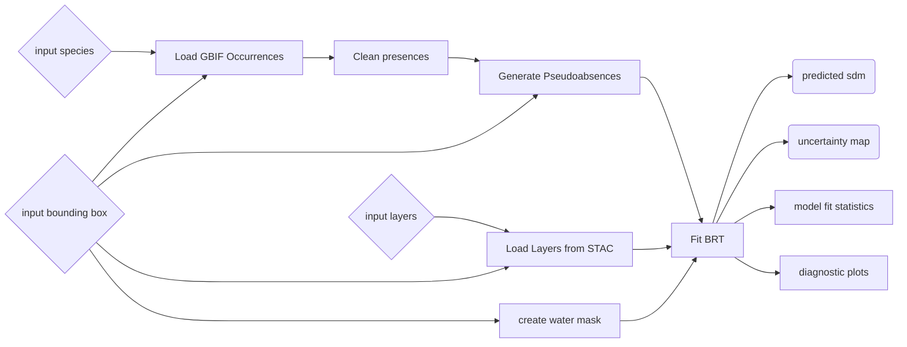

_Auteur: Michael D. Catchen_

Statut de révision: En développement

Ce document décrit la méthodologie derrière le pipeline BON in a Box pour l'utilisation de arbres de régression boostés (BRT) pour la modélisation de la distribution des espèces.

# Résumé

> [!WARNING]
> Cela devrait vraiment changer pour AP étant dans un script séparé de BRT, mais que
> n'est pas comment `fitBRT.jl` fonctionne actuellement

Ce pipeline construit un modèle pour prédire la distribution d'une espèce (un type de Variable essentielle de biodiversité), en utilisant les données occurrence du Système mondial d'information sur la biodiversité (GBIF) et les prédicteurs environnementaux d'un catalogue STAC arbitraire.

En particulier, ce pipeline utilise un modèle spécifique appelé arbre de régression boosté (BRT), un modèle d'apprentissage automatique qui a tendance à bien fonctionner avec les données spatiales. Les détails sur le fonctionnement d'un BRT sont dans la description du script clé dans le pipeline, [`fitBRT.jl`](../../scripts/SDM/BRT/fitBRT.md).

## Entrées:

- **Espèces**: Le nom du taxon construit un modèle de répartition des espèces pour
- **Prédicteurs environnementaux**: Ensemble de prédicteurs environnementaux à utiliser
- **Système de coordonnées de référence**: Le système de coordonnées de référence à utiliser pour l'analyse
- **Emprise**: Le emprise pour l'analyse, donné dans le même système de coordonnées de référence que celui mentionné ci-dessus
- **GBIF Source de données**: source de données GBIF à utiliser
- **Année de début** : la première année pour sélectionner occurrences
- **Année de fin** : la dernière année pour sélectionner occurrences
- **Résolution spatiale**: la résolution spatiale de l'analyse en mètres
- **Masque** : masque de régions à ignorer
- **STAC URL** : l'URL du catalogue STAC où les prédicteurs environnementaux sont hébergés

## Sorties

- **Prédicté SDM** : carte du score occurrence prévu à chaque emplacement
- **SDM Incertitude**: carte de l'incertitude relative du SDM à chaque emplacement
- **Statistiques d'ajustement**: décrit différentes mesures de la qualité du modèle sur l'ensemble d'essai
- **Pseudoabsences** : lieux générés où l'on suppose qu'il n'y a pas d'espèce, d'après les huéristiques.

[Voir un exemple sortie du pipeline ici](https://pipelines-results.geobon.org/viewer/_2025-10-16%3ESDM%3ESDM_BRT%3E933ca049e112ab67db9711517e6ee30a)

> [!IMPORTANT]
> L'utilisation de BRT pour s'adapter à un modèle de distribution des espèces nécessite * des données sur l'absence*. Pour la majorité des espèces où il n'existe pas de données sur l'absence, il existe diverses méthodes pour générer des pseudo-absences (AP) basées sur l'heuristique de l'espèce occurrence. Cependant, les caractéristiques de performance d'un ajustement SDM utilisant AP peuvent être très variables selon la méthode et les paramètres utilisés pour générer AP. Cela signifie que les résultats de BRT doivent être explicitement considérés en fonction de la façon dont AP a été généré, et l'analyse de sensibilité à différents AP est *hautement* encouragée.

- **Carte de répartition**: aire de répartition de l'espèce, calculé en déterminant le SDM prévu au seuil optimal (défini comme le seuil le maximise le coefficient de corrélation de Matthew)
- **Espace environnemental**: diagnostic **corners graphique** des emplacements de occurrences et pseudo-absences dans l'espace environmental
- **Courbe tournante** : diagnostic **courbe de réglage** graphique de la valeur du coefficient de corrélation de Matthew sur diverses valeurs de seuil entre 0 et 1.
- **Présences**: données occurrence nettoyées après nettoyage
- **DOI du téléchargement GBIF**

# Étapes du pipeline

